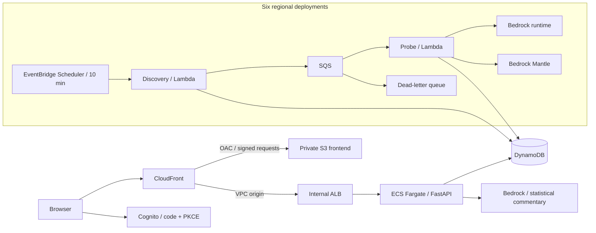

# Bedrock Probe

A regional streaming benchmark for Amazon Bedrock with a static dashboard, an ECS API, and Lambda probes every ten minutes. Infrastructure is deployed directly with **AWS CLI/Boto3**, using the existing default VPC in each region. No Terraform or CloudFormation is required.

The implementation includes a compact performance dashboard, model discovery and probe management, four streaming API adapters, failure reporting, raw-sample storage, exact percentile aggregation, automatic dashboard refresh, anomaly highlighting, Bedrock AI observations, and Cognito sign-in. See [the deployment guide](docs/deployment.md) for account setup and operation.

## Recommended architecture

Use **Lambda for the probes** and **ECS Fargate for the dashboard API**. The probes are short, independent network requests with long idle periods between runs. Scheduling a fresh Fargate task for every measurement adds startup delay and operational overhead. A scheduler embedded inside the ECS web service would also need a distributed lock as the service scales.



Workers run inside the default VPC in the same AWS region as the endpoint they probe. The deployment reuses existing private subnets with NAT egress; where none exist, it creates dedicated probe subnets and a NAT gateway inside that default VPC. It does not create VPCs or alter existing subnet routing. Timing starts just before the inference request; Lambda startup, discovery, DynamoDB writes, credential lookup, and signing are outside the measured interval.

The ECS service uses two private Fargate tasks, an internal ALB, and a CloudFront VPC origin. Existing NAT egress provides ECR, logging, and Cognito connectivity; existing regional DynamoDB and S3 gateway endpoints can also be used. For stronger availability, use one NAT gateway per availability zone. `api_region` can differ from `home_region`; cross-region storage requests then use NAT, while probe timing remains regional.

| Location | AWS region |
|---|---|
| N. Virginia | `us-east-1` |
| Ohio | `us-east-2` |
| Oregon | `us-west-2` |
| Tokyo | `ap-northeast-1` |
| Singapore | `ap-southeast-1` |
| Frankfurt | `eu-central-1` |

Collection and deployment are limited to the six regions above. The API rejects
queries for other regions.

## Model and API coverage

Discovery runs every ten minutes and selects **Claude ≥ 4.8** and **GPT ≥ 5.6**, including Claude 5.5 and GPT 6 families. New matching versions are automatically included, subject to `max_targets_per_region`. Discovery uses regional `ListFoundationModels`, `ListInferenceProfiles`, and Mantle's Models API. An empty catalog or failed discovery stays visible.

These official AWS model cards were checked while building this implementation:

- [Claude Opus 4.8](https://docs.aws.amazon.com/bedrock/latest/userguide/model-card-anthropic-claude-opus-4-8.html)
- [Claude Sonnet 5.5](https://docs.aws.amazon.com/bedrock/latest/userguide/model-card-anthropic-claude-sonnet-5-5.html)
- [GPT 5.6 Sol](https://docs.aws.amazon.com/bedrock/latest/userguide/model-card-openai-gpt-56-sol.html)
- [GPT 6 Astra](https://docs.aws.amazon.com/bedrock/latest/userguide/model-card-openai-gpt-6-astra.html)

Availability varies by model, API, region, account permissions, Marketplace access, and endpoint surface. A discovered candidate is **not** a promise that every API invocation will succeed. Unsupported combinations and access failures are recorded; no model IDs or fallback regions are silently substituted.

Use `infra/config.json` settings `model_id_regex`, `apis`, and `routing_modes` to narrow the probe matrix without code changes. `input_sizes` controls which presets are scheduled; the dashboard's input selector filters results already collected.

| Provider | Endpoint | Adapter |
|---|---|---|
| Anthropic | runtime | `ConverseStream` |
| Anthropic | runtime and Mantle | Anthropic Messages SSE, `/anthropic/v1/messages` |
| OpenAI | runtime and Mantle | Responses SSE, `/openai/v1/responses` |
| OpenAI | runtime and Mantle | Chat Completions SSE, `/openai/v1/chat/completions` |

Runtime base host: `https://bedrock-runtime.REGION.amazonaws.com`.
Mantle base host: `https://bedrock-mantle.REGION.api.aws`.

For the requested closed-weight GPT families, the model cards specify **`/openai/v1` on Mantle**, although other Mantle models use `/v1`. Runtime does **not** expose OpenAI `GET /models`. GPT runtime requests use discovered system inference profile IDs, such as `global.openai.gpt-6-astra`, rather than assuming the foundation model ID supports direct regional inference.

All requests use IAM role credentials and SigV4. No OpenAI API key is needed. AWS model access must already be enabled; The deployment does not accept Marketplace agreements. Future model-specific route or payload changes belong in `probe/config.py` and `probe/adapters.py`.

Both regional and profile-based targets can appear. `region` means the **endpoint and worker region**. `routing` distinguishes `regional`, `geographic`, and `global`; a profile can execute in another region. Actual serving region is not asserted when the API does not return it.

Discovered regional, geographic and global targets are enabled by default,
including eligible Fable Runtime profiles and Mantle targets.
`fable_global_only=false` allows all discovered Fable routing modes.
Only routes actually returned by regional discovery are scheduled. Global routing
does not override account data-retention requirements or guarantee a particular
serving region.

Some models require an account data-retention configuration compatible with the
selected region and endpoint. For Fable under `aws_review`, AWS may retain
prompts and responses within AWS for up to 30 days for human review. Such settings
affect other callers in the same regional account and endpoint scope. Configure
them according to your account's requirements and the current AWS documentation.
Normal application deployment does not modify account retention.

## Measurement contract

| Metric | Definition |
|---|---|
| `ttft_ms` | Request start → first nonempty visible text delta |
| `ttot_ms` | Request start → stream closes, including final usage |
| `last_text_ms` | Request start → last visible text delta |
| `output_tps` | Reported output tokens × 1,000 / TTOT in ms |
| `decode_tps_estimate` | (visible output tokens − 1) / (last text time − first text time), when calculable |
| `input_tokens`, `output_tokens` | Provider-reported usage; absent usage remains null |
| `reasoning_tokens`, cache usage | Recorded when returned |
| `queue_delay_ms` | Actual attempt start minus the nominal schedule slot |

Timing uses a monotonic clock. First role, metadata, heartbeat, and reasoning events do not count as TTFT. Stream chunks are never treated as tokens. Provider output usage may include reasoning. Decode throughput is explicitly an estimate because one chunk can contain several tokens and visible token usage is not always available.

All performance time metrics use **milliseconds (ms)** throughout the metric
cards, result tables, issue descriptions, thresholds, statistical evidence, and
AI conclusions. Throughput remains tokens/s. UTC timestamps, schedule intervals
and time-range selectors retain their normal calendar/cadence units.

Input selectors are **literal 1, 10, and 100 tokens, not thousands**, measured on prompt text using the `cl100k_base` reference tokenizer. Every model receives the same text for a given preset. Actual model tokenization and message framing can differ; actual usage remains available in the API, but is omitted from the results table. Exactly one billed input token is generally impossible for a chat request.

The ten-token prompt is “Write a story about a journey through outer space.” The 100-token prompt repeats it ten times; the one-token prompt is “Hello.” The preset tests verify these reference counts. Because the one-token prompt cannot include a length instruction, its output may be short. Compare each input size independently.

The current default output cap is **2,048 tokens**, including any reasoning tokens. Earlier 512-token runs often exhausted their budget before Claude Opus 5/5.5 or GPT-6 Sol returned visible text. **Opus 5 and Haiku 5.5 probes disable optional thinking** to avoid reasoning-only responses. Other model versions retain model-default reasoning; Opus 5.5, Sonnet 5.5 and Fable require adaptive thinking and reject disabling it. New models keep their defaults until their reasoning controls have been verified. `anthropic_thinking` can be `disabled` or `model-default` and applies only to the two verified opt-out models. Historical reasoning settings and output budgets remain separate configurations, and queued jobs retain their original settings during deployment. Requests do not assume universally supported temperature controls. Identical prompts may benefit from implicit provider caching. This is a repeated-request benchmark, not a guaranteed cold-cache benchmark.

Each adapter creates a fresh connection per probe. TTFT therefore includes DNS/TLS/connection establishment. This is a controlled connection policy, but it differs from a production service reusing connections.

## Scheduling and failure handling

- Each target is one region × model/inference profile × endpoint × API. Each selected input size produces one job per ten-minute slot. UTC cron scheduling aligns all regions to minutes 00, 10, 20, 30, 40, and 50.
- If Scheduler leaves its scheduled-time context token unexpanded, the planner uses the invocation's current ten-minute UTC slot and records `schedule_time_source=invocation` on the catalog and jobs. A valid supplied scheduled time remains authoritative.
- SQS fans out jobs with configurable worker concurrency, currently 15 per region. One Lambda handles one request with a 120-second deadline and a 150-second Lambda timeout.
- Inference SDK retries are disabled. A measured failure remains a failure.
- Conditional DynamoDB claims deduplicate SQS delivery. If a worker dies after claiming, a later delivery records `worker_timeout` rather than making a second potentially billable inference request. A storage failure after successful inference can therefore lose that measurement; the code favors avoiding duplicate inference.
- A queued job more than ten minutes late is marked `stale`. Queue lag is measured separately from model latency.
- Scheduler/Lambda delivery failures and SQS failures have dead-letter queues. CloudWatch alarms cover Lambda errors, queue age, and dead letters. Connect the regional CloudWatch alarms to existing SNS topics if notifications are needed.
- Access failures, throttling, invalid API/model combinations, no visible text, and incomplete streams stay visible in the dashboard. Model access failures do not fail the Lambda invocation itself.
- A planner that would exceed the configured target budget records an issue and sends no jobs. It does not silently trim the catalog.

## Local preview and tests

Requires Python 3.12+, AWS CLI v2, and Docker Buildx for deployment. Local preview needs only Python.

```bash
python3 -m venv .venv
.venv/bin/pip install -e '.[dev]'
.venv/bin/pytest -q
LOCAL_DEV=1 .venv/bin/uvicorn probe.api:app --host 127.0.0.1 --port 8000
```

Open `http://localhost:8000`. Without `TABLE_NAME`, the preview shows honest empty states and makes no AWS calls. `LOCAL_DEV=1` disables authentication and is for localhost only; it is never set in the ECS task definition.

For a read-only account catalog inspection:

```bash
AWS_PROFILE=your-profile .venv/bin/python -m probe.discovery --region us-east-1
```

This command discovers models; it does not invoke them.

## AWS CLI / Boto3 deployment

Deployment configuration is in `infra/config.json`. The deployment uses each region's existing default VPC and fails explicitly if one is missing. It reuses existing NAT routes where available and adds application-specific private subnets and NAT only where necessary. Lambda functions inside public subnets do not receive public IP addresses, so an Internet Gateway alone cannot provide their egress.

```bash
bash scripts/package_lambda.sh
probe_image_tag=$(.venv/bin/python -c 'import json; print(json.load(open("infra/config.json"))["api_image_tag"])')
AWS_REGION=us-east-1 bash scripts/push_api.sh "$probe_image_tag"
.venv/bin/python -m infra.aws_deploy --part all --update-code
```

The image tag must match `api_image_tag`. ECR tags are immutable; use a new tag for later API releases. `api_architecture` selects `X86_64` or `ARM64`. The image build script reads it automatically. Rebuild the Lambda ZIP after Python changes and include `--update-code` to publish it.

You can reconcile only the dashboard or only the regional workers:

```bash
.venv/bin/python -m infra.aws_deploy --part dashboard
.venv/bin/python -m infra.aws_deploy --part regions --update-code
```

The deployment uploads frontend assets to private S3, configures CloudFront OAC and a VPC origin, reconciles regional IAM/SQS/Lambda/Scheduler resources, and waits for the ECS service to stabilize. The dashboard URL and Cognito identifiers are written to `.build/dashboard-deployment.json`; network IDs are written to `.build/default-networks.json`. AWS remains the source of truth; no infrastructure state engine is used.

Create dashboard users administratively in the Cognito pool. **Self-registration is disabled.** Opening the homepage without a session redirects directly to Cognito. The dashboard stays hidden until the API validates the session; invalid or expired sessions return to sign-in. The frontend uses authorization code flow with PKCE. The API verifies Cognito access-token signature, issuer, expiration, token type, and configured app client. Administrator-created users can read the dashboard. Only members of the `probe-admins` Cognito group can change probe selections or request discovery. The deployment creates the group without automatically assigning new users. The deployment does not send invitations.

Set `schedule_enabled` to `false` and reconcile regional workers to pause future probing. Already queued work can still run until its ten-minute freshness limit. Configuration changes can increase invocation volume; review the capacity formula below.

## Period aggregation and API

The compact workspace has **Overview** and **Management**. Model catalog and
Methodology pages have been removed. Overview uses a full-width table with sticky
headers, compact filters/cards, a separate Issues column, permanently visible
latency and throughput charts, and expandable AI and threshold panels. Measurement definitions remain in this README.

Management lists the models and inference profiles actually returned by Bedrock
in the six active regions. Search and multi-select filters narrow the regional
model/API targets. Select rows and choose **Add selected to probes** or
**Pause selected**. Changes persist in DynamoDB and apply when each regional
planner starts its next ten-minute run. Already queued work can finish; historical
results remain available. The Collection column distinguishes saved selections
from the policy revision last applied by the scheduler.

**Discover latest** requests a discovery-only invocation of each regional
planner. The page polls regional discovery timestamps and displays partial
failures. It neither submits inference jobs nor replaces the last scheduled-run
record. Requests share a one-minute cooldown. Failed discovery surfaces retain
their previously known targets with visible notices; successful complete lists
can remove targets that are no longer available.

Automatic addition of newly discovered eligible models is enabled by default.
Turning it off preserves existing probe selections and leaves future discoveries
available for explicit addition. Turning it on preserves explicit pauses. All
available routing modes are enabled by default. The optional `fable_global_only`
setting is shared by planners and Management if a later deployment narrows Fable
coverage. A 100-target limit per region remains enforced. Concurrent policy edits use revision checks and
return HTTP 409 rather than overwriting another administrator's changes.

To grant management access to an existing user:

```bash
aws cognito-idp admin-add-user-to-group --region us-east-1 \
  --user-pool-id USER_POOL_ID --username USER_EMAIL --group-name probe-admins
```

Sign out and sign in after changing group membership to obtain a new access token.

The dashboard offers 10-minute, hourly, and daily buckets, plus time ranges through 30 days. Results include mean, p50, p95, p99, counts, pending jobs, and success rate. UTC bucket assignment uses the nominal scheduled slot; actual attempt time and queue lag remain available on raw records.

The separate **Issues** column distinguishes latest failures, recovery, historical failures, high latency, limited samples, and pending probes. Window Success contains only the selected-window rate and completed counts. Summaries expose `latest_health`, `failure_counts`, `status_counts`, `last_failure`, `reasoning`, and `max_output`. A later successful scheduled probe marks an earlier failure as recovered only within the same input/configuration cohort. Pending work and manual checks cannot clear a failure. Superseded configurations and targets absent from a fresh, complete catalog are labelled historical. Their failures remain in window statistics.

Dashboard metrics exclude manual verification runs by default, matching AI stability observations. Those records remain in DynamoDB and are available for diagnostics with `include_verification=true` on `/api/metrics`. This flag does not change the scheduled-only latest-health calculation.

```text
GET /health
GET /api/config
GET /api/catalog
GET /api/metrics?start=UNIX_SECONDS&end=UNIX_SECONDS&period=3600
GET /api/analysis?start=UNIX_SECONDS&end=UNIX_SECONDS&period=3600&dimension=model_id
GET /api/management
PATCH /api/management/policy
POST /api/management/discover
```

Authenticated metric filters: `region`, `provider`, `endpoint`, `model`, `api`, `input_size`.
Each accepts repeated query parameters, for example
`region=us-east-1&region=ap-northeast-1&model=MODEL_A&model=MODEL_B`.
Values within one filter use OR; different filters use AND. Missing filters include
all values. Filter order and duplicate values do not create separate analysis caches.
The interval is `[start, end)`. API time range limit: 31 days.

Time range and aggregation each use a single-select dropdown. Other dashboard filters
support multiple selections through searchable checkbox menus. Model options include
only targets in the selected regions and providers, using OR within each filter and
AND between filters. Changing a region or provider keeps compatible model selections
and clears incompatible selections before requesting metrics or analysis. Empty parent
filters include all regions or providers. Selected analysis dimensions have separate tabs. Multi-selected
input presets are pooled from raw samples within otherwise identical configurations
for the table and charts; no input column is displayed. AI time comparisons still
require identical inputs. Empty categorical filters include all values.

DynamoDB partitions raw samples by region and UTC date. Queries paginate all selected partitions, then compute exact percentiles from successful raw samples. Errors are excluded from latency percentiles and included in success rate. Pending jobs are excluded from the success-rate denominator. A completely missing scheduler run is **not** counted as successful; catalog timestamps and data freshness expose missing collection separately.

**Initial implementation limit: 100,000 raw samples per query.** Oversized requests return HTTP 413 instead of partial aggregates. Select a shorter time range or one region. Model/provider/API filters apply after the regional reads, so they do not bypass the read limit. With many discovered models, a month of all-region data will exceed this limit.

For sustained large-scale monthly views, add DynamoDB Streams → S3 Parquet and Athena for historical queries, or materialized hourly/daily aggregates with a mergeable quantile sketch. Do not average p95 values from different buckets. The current implementation intentionally keeps exact raw percentiles and exposes its query limit.

## Automatic refresh and observations

The dashboard refreshes every minute by default. Users can select 30 seconds, one minute, five minutes, or off. A countdown and last-update time show its state. Hidden tabs pause refresh and resume when visible; overlapping requests and obsolete filter responses are cancelled. This refreshes the view; probe collection still runs every ten minutes.

Result rows retain anomaly colors, with explanations in Issues. TTFT p95 is yellow at 5,000 ms and red at 10,000 ms; TTOT p95 is yellow at 30,000 ms and red at 60,000 ms. Latest failed outcomes are red, recovered outcomes are green, and historical failure details are neutral. Window success rates remain accurate and are labelled separately from latest health. Latency coloring requires at least five successful samples and remains visible after an invocation issue recovers. These are observation thresholds, not service SLAs. All dashboard text, statistical observations, and AI conclusions are in English.

The authenticated analysis endpoint accepts the metric filters plus `dimension=model_id|region|provider|endpoint|api`. Historical trends use the selected duration and aggregation period, ending at the latest completed ten-minute boundary. Separately labelled latest-health evidence also considers newer completed scheduled probes from the collecting interval. Manual verification probes are excluded. The model distinguishes old restrictions from current failures and does not infer a reasoning-setting change merely because different models use different defaults.

Time comparisons require the same region, model, provider, endpoint, API, routing, input preset, and configuration ID on both sides. Each side needs at least three completed samples; latency comparisons also need three successful metric samples. Fewer than 20 completed samples per side is marked limited evidence. Aggregates across different configurations remain descriptive and are not used to declare one region inherently faster. A missing observation is not counted as a model failure.

Bedrock `global.anthropic.claude-haiku-5-5` turns this aggregate evidence into short English conclusions about stability, latency, time changes, and suggested checks. The analysis call receives aggregate statistics, not raw probe prompts, completions, or credentials. It disables extended thinking and has a separate 1,536-token output budget so reasoning does not consume the short conclusion's allowance. Model errors, limits, or insufficient data retain the statistical observations without inventing an AI conclusion.

Analysis results share a ten-minute DynamoDB cache across ECS tasks, with a conditional generation lease and a default budget of 20 model calls per ten-minute interval across all users and filter combinations. A failure/recovery change invalidates the analysis identity without waiting for the next time bucket; ordinary successful refreshes keep the same identity. Failed or limited analyses retry after one minute. Settings are `analysis_model_id`, `analysis_region`, and `analysis_max_calls_per_10_minutes` in `infra/config.json`. Changing the model requires reconciling its scoped IAM permission. API writes are limited to `ANALYSIS#*` cache/budget and `MANAGEMENT#*` policy/cooldown partitions; probe records remain read-only to the API. The API can invoke only the six regional planner functions for discovery.

## Capacity and cost

Daily inference requests:

```text
144 ten-minute slots × selected input sizes × sum(discovered targets across regions)
```

For example, 50 targets in each of 6 regions and all 3 sizes means **129,600 requests/day**. With a 2,048-token output cap, the cap alone permits up to 265.4 million output tokens/day. Actual charges depend on the model, reasoning, caching, output length, and profile pricing. New discovered models increase the request volume.

Choose worker concurrency using approximately:

```text
jobs per region per slot × mean request duration / 600 seconds
```

Add headroom and remain below model quotas. If a region has 150 jobs taking 30 seconds each, 5 workers cannot keep up; increase concurrency or reduce selected models/APIs/sizes. At large volume, a warm ECS worker pool can be cheaper and can support requests longer than Lambda's limits; preserve the same SQS job and measurement contracts.

Infrastructure also includes two continuously running Fargate API tasks, an ALB, NAT egress in the probe regions, DynamoDB, CloudFront, CloudWatch, and six regional SQS/Lambda deployments. Lambda is not the only cost component.

Opening a new analysis window or changing its filters/dimension can incur a Bedrock analysis call. Cached views do not invoke the model again; the shared analysis budget bounds calls independently of probe traffic.

## Sources

- [AWS endpoint differences](https://docs.aws.amazon.com/bedrock/latest/userguide/endpoints.html)
- [AWS endpoint regions](https://docs.aws.amazon.com/bedrock/latest/userguide/endpoints-region-availability.html)
- [AWS Responses API and runtime profile requirements](https://docs.aws.amazon.com/bedrock/latest/userguide/inference-responses-api.html)
- [AWS Chat Completions API](https://docs.aws.amazon.com/bedrock/latest/userguide/inference-chat-completions.html)
- [AWS Anthropic Messages API](https://docs.aws.amazon.com/bedrock/latest/userguide/inference-messages-api.html)
- [OpenAI streaming event semantics](https://developers.openai.com/api/docs/guides/streaming-responses)

AWS documentation determines Bedrock routes and availability. OpenAI API availability alone does not establish availability through Bedrock.
